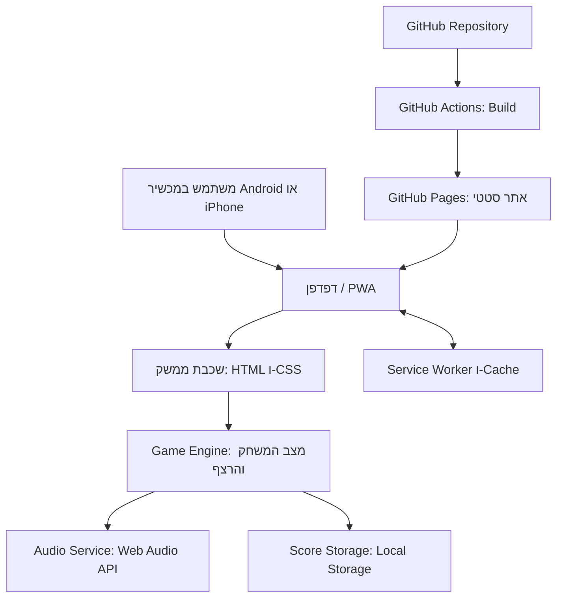

# ARCHITECTURE.md — משחק Simon

## 1. Technology Stack שנבחר

### 1.1 הטכנולוגיות

| תחום | בחירה | תפקיד |
|---|---|---|
| שפת פיתוח | TypeScript | מימוש לוגיקת המשחק, ניהול מצבים וטיפול בנתוני הניקוד עם בדיקת טיפוסים בזמן פיתוח. |
| ממשק משתמש | HTML5 ו־CSS3 רגילים | בניית שני המסכים ועיצוב Mobile-First, ללא Framework של UI. |
| Build Tool ושרת פיתוח | Vite | סביבת פיתוח מהירה ובניית קבצים סטטיים להפצה. |
| PWA ו־Offline | `vite-plugin-pwa` עם Workbox | יצירת Web App Manifest ו־Service Worker, ושמירת משאבי האפליקציה הנדרשים לשימוש Offline. |
| צלילים | Web Audio API | יצירת ארבעה צלילים באמצעות קוד, ללא הורדת קובצי שמע או שירות חיצוני. |
| אחסון מקומי | `localStorage` | שמירת התוצאה האחרונה והשיא האישי במכשיר ובדפדפן הנוכחיים. |
| בדיקות לוגיקה | Vitest | בדיקות אוטומטיות ללוגיקת המשחק ולחישוב הניקוד, ללא צורך בשרת. |
| ניהול קוד מקור | Git ו־GitHub | ניהול גרסאות, שיתוף קוד והיסטוריית שינויים. |
| CI/CD ו־Hosting | GitHub Actions ו־GitHub Pages | Build אוטומטי ופרסום האתר הסטטי בעקבות שינוי בענף `main`. |

**אין צורך** ב־Backend, ב־Database, ב־Authentication, באחסון קבצים בענן, ב־API חיצוני, בשירות AI או בשירות תשלום.

### 1.2 נימוקים לבחירות

- **TypeScript ללא UI Framework:** המשחק כולל מסך משחק ומסך אודות, עם לוגיקת משחק מוגדרת היטב. TypeScript מספק בדיקת טיפוסים, אך שימוש ב־React או Vue יוסיף שכבת מורכבות שאינה נדרשת למוצר קטן זה.
- **Vite:** כלי Build בשל ונפוץ ליישומי Frontend סטטיים, עם תיעוד רשמי הכולל הנחיות ייעודיות ל־GitHub Pages. הוא מטפל ב־TypeScript ובאריזת משאבי הפרויקט.
- **`vite-plugin-pwa` ו־Workbox:** מאפשרים ליצור ולתחזק את קובצי ה־PWA וה־Service Worker כחלק מתהליך ה־Build, במקום לממש מנגנון Cache ידני.
- **Web Audio API:** ארבעת הצלילים יכולים להיווצר באמצעות מתנדים (oscillators) ומשך צליל קצר. כך אין תלות בקובצי שמע חיצוניים, וכל רכיבי המשחק יכולים להיכלל ב־Cache.
- **Local Storage:** מתאים לשני ערכי ניקוד קטנים הנשמרים באותו דפדפן. אין צורך ב־Database או בסנכרון.
- **GitHub Pages:** מתאים לאתר סטטי ללא Backend, ומאפשר פריסה דרך GitHub Actions לאחר Build. יש להגדיר את נתיב הבסיס (base path) בהתאם לשם ה־Repository.

### 1.3 חלופות שנבחנו בקצרה

| רכיב | חלופות רלוונטיות | החלטה ונימוק |
|---|---|---|
| ממשק משתמש | Vanilla TypeScript; React; Vue | נבחר Vanilla TypeScript. React ו־Vue מתאימים ליישומים מורכבים יותר, אך אינם נחוצים לשני מסכים ולמכונת מצבים קטנה. |
| Build | Vite; Parcel; Webpack | נבחר Vite בשל תהליך Build פשוט ותיעוד ישיר לפריסה ב־GitHub Pages. Webpack גמיש אך דורש בדרך כלל יותר תצורה; Parcel הוא חלופה אפשרית אך אינו נותן כאן יתרון מהותי. |
| PWA | `vite-plugin-pwa` עם Workbox; Service Worker ידני | נבחר התוסף כדי לצמצם קוד תחזוקה ידני ולשלב יצירת Cache ב־Build. Service Worker ידני אפשרי, אך ידרוש ניהול Cache ועדכונים בעצמנו. |
| שמע | Web Audio API; קובצי audio; Tone.js | נבחר Web Audio API המובנה בדפדפנים. קובצי שמע יוסיפו נכסים ל־Cache, ו־Tone.js מספק יכולות מוזיקליות מתקדמות שאינן נחוצות. |
| Hosting | GitHub Pages; Vercel; Netlify | נבחר GitHub Pages בהתאם להעדפת הפריסה ולכך שהמוצר סטטי בלבד. Vercel ו־Netlify יכולים לפרוס אתר כזה, אך אינם נדרשים כאן. |
| אחסון | Local Storage; IndexedDB; Database בענן | נבחר Local Storage משום שנדרשים רק שני מספרים קטנים, ללא שאילתות, קשרים או סנכרון. |

### 1.4 עלויות, בשלות ומקורות

הבחירות נשענות על Web APIs סטנדרטיים, כלים מבוססים ותיעוד רשמי. אין שירות Backend או Database שדורש תשלום תפעולי, ואין תלות בשירות AI או API בתשלום. GitHub Pages כפוף לתנאי השירות ולמגבלות השימוש של GitHub; יש לבדוק את התנאים העדכניים של החשבון וה־Repository לפני פרסום ציבורי.

מקורות רשמיים:
- [Vite — Deploying a Static Site / GitHub Pages](https://vite.dev/guide/static-deploy.html)
- [TypeScript Handbook](https://www.typescriptlang.org/docs/handbook/intro.html)
- [vite-plugin-pwa — תיעוד ויכולות](https://github.com/vite-pwa/vite-plugin-pwa)
- [MDN — Making PWAs installable](https://developer.mozilla.org/en-US/docs/Web/Progressive_web_apps/Guides/Making_PWAs_installable)
- [MDN — Web Audio API best practices](https://developer.mozilla.org/en-US/docs/Web/API/Web_Audio_API/Best_practices)
- [GitHub Docs — יצירת אתר GitHub Pages](https://docs.github.com/en/pages/getting-started-with-github-pages/creating-a-github-pages-site)
- [GitHub Docs — מגבלות GitHub Pages](https://docs.github.com/en/pages/getting-started-with-github-pages/github-pages-limits)

### 1.5 סיכונים ומגבלות

- **התקנת PWA אינה אחידה בכל הדפדפנים:** אופן ההתקנה משתנה בין Android ל־iOS ובין דפדפנים. יש לספק הוראות התקנה מתאימות כאשר נדרש, ולא להבטיח כפתור התקנה אחיד בכל מכשיר.
- **השמעת שמע דורשת אינטראקציה של המשתמש:** דפדפנים עשויים לחסום שמע לפני אינטראקציה. יש ליצור או להפעיל מחדש את `AudioContext` בעקבות לחיצה על „התחל”, לפני ניגון הרצף הראשון.
- **Local Storage אינו סנכרון ענני:** התוצאות שייכות לדפדפן ולמכשיר שבהם נשמרו. ניקוי נתוני הדפדפן עלול למחוק אותן.
- **Cache וגרסאות חדשות:** יש להגדיר את Service Worker כך שמשאבי הגרסה החדשה ייכנסו ל־Cache בצורה עקבית, ולבדוק עדכון גרסה בלי להשאיר משתמשים עם קבצים מעורבים מגרסאות שונות.
- **GitHub Pages הוא Hosting סטטי:** הוא אינו מריץ Backend. זה תואם במדויק את דרישות המוצר.
- **מגבלות פרסום:** לפי תיעוד GitHub Pages, קיימות מגבלות על גודל האתר, רוחב פס וקצב Build. המשחק צפוי להיות קטן, אך יש להימנע משימוש ב־GitHub Pages אם אופי השימוש העתידי חורג מתנאי השירות או מהמגבלות הרלוונטיות.

## 2. ארכיטקטורת המערכת

### 2.1 מבט כללי

המערכת היא יישום Client-Side סטטי. הדפדפן מוריד את קובצי האתר דרך HTTPS, ולאחר טעינה ראשונה ה־Service Worker מאפשר לטעון את משאבי האפליקציה מה־Cache גם ללא אינטרנט. לוגיקת המשחק, השמע, הצגת המסכים ושמירת הניקוד מתבצעים כולם במכשיר המשתמש.

אין תקשורת Runtime עם API או שרת יישומי. GitHub משמש לניהול קוד ולפרסום בלבד, ולא לאחסון נתוני משתמשים.

### 2.2 Modules ושכבות לוגיות

#### A. Presentation Layer — ממשק משתמש
אחריות:
- הצגת מסך הבית, לוח המשחק וארבעת לחצני הצבעים.
- הצגת השלב הנוכחי, מספר השלבים שהושלמו והוראות המשחק.
- הצגת חיווי הצלחה, הודעת הפסד או הודעת ניצחון.
- הצגת התוצאה האחרונה והשיא האישי במסך „אודות”.
- ניווט בין מסך המשחק למסך „אודות”.
- חסימת לחצני הצבעים כשהמשחק אינו במצב קבלת קלט.

הממשק יהיה בעברית ויוגדר ב־HTML עם `lang="he"` ו־`dir="rtl"`. צבעי המשחק יישארו מזוהים באופן ברור, והחיווי לא יסתמך על צבע בלבד.

#### B. Game Engine — לוגיקת המשחק
אחריות:
- יצירת רצף אקראי.
- ניהול השלב ומיקום הקלט הנוכחי ברצף.
- מעבר בין הצגת הרצף לתור השחקן.
- בדיקת כל לחיצה מול הצבע הצפוי.
- חישוב התוצאה והחלטה על הצלחה, כישלון או ניצחון.
- מניעת קלט בזמן הצגת הרצף, בזמן מעבר בין שלבים ולאחר סיום המשחק.

מכונת המצבים המומלצת:

- `idle` — המשחק טרם התחיל.
- `showing-sequence` — המערכת מציגה ומשמיעה את הרצף.
- `player-turn` — השחקן רשאי ללחוץ על צבעים.
- `transition` — חיווי הצלחה קצר לפני השלב הבא.
- `game-over` — המשחק הסתיים עקב טעות.
- `won` — השחקן השלים את כל 10 השלבים.

כל אירוע משתמש יעבור דרך Game Engine. רכיבי הממשק לא ישנו ישירות את הרצף או את הניקוד.

#### C. Audio Service — ניהול צלילים
אחריות:
- יצירת ארבעה צלילים שונים באמצעות Web Audio API.
- השמעת הצליל המתאים בעת הצגת צבע ברצף ובעת לחיצה תקפה של השחקן.
- תזמון צלילים והארת לחצן באופן עקבי.
- הפעלת `AudioContext` או חידושו בעקבות לחיצת המשתמש על „התחל”, כדי לעמוד במדיניות Autoplay של הדפדפן.

אין צורך בקובצי שמע חיצוניים. אם הדפדפן אינו מאפשר להשמיע צליל לפני אינטראקציה, המשחק יתחיל את מנגנון השמע במסגרת לחיצת „התחל”.

#### D. Score Storage — אחסון תוצאות
אחריות:
- קריאה וכתיבה של התוצאה האחרונה ושל השיא האישי ב־Local Storage.
- אימות הערכים שנקראו לפני השימוש בהם.
- טיפול בנתונים חסרים או פגומים ובחריגות גישה לאחסון.

הממשק יקבל את נתוני הניקוד דרך שכבת האחסון, ולא ייגש ל־Local Storage ישירות.

#### E. PWA Runtime
אחריות:
- טעינת Web App Manifest.
- רישום Service Worker.
- שמירת קובצי ה־HTML, JavaScript, CSS, האייקונים ומשאבים מקומיים הנדרשים ב־Cache.
- אספקת משאבים שמורים בעת פתיחה Offline.
- ניהול עדכון Cache בעת פרסום גרסה חדשה.

יש להעדיף יצירת הצלילים בזמן ריצה כדי שלא תהיה תלות בקובצי שמע חיצוניים.

## 3. Data Model ואחסון

### 3.1 נתונים בזיכרון בזמן משחק

מצב המשחק קיים בזיכרון בלבד וכולל:

| שדה לוגי | משמעות |
|---|---|
| `status` | מצב המשחק הנוכחי מתוך מכונת המצבים. |
| `sequence` | מערך צבעים אקראי המצטבר עד אורך 10. |
| `currentLevel` | מספר השלב הנוכחי, בין 1 ל־10. |
| `playerInputIndex` | מיקום הצבע הבא שהשחקן צריך לשחזר. |
| `completedLevels` | מספר השלבים שהושלמו בהצלחה. |

מצב המשחק אינו נשמר ב־Local Storage. רענון הדף מאפס את המשחק ומחזיר אותו ל־`idle`.

### 3.2 נתונים מתמידים

יישמרו שני ערכים מספריים בלבד:

| מפתח מוצע | סוג | משמעות |
|---|---|---|
| `simon.lastResult` | מספר שלם בטווח 0–10 | התוצאה של המשחק האחרון שהסתיים. |
| `simon.bestScore` | מספר שלם בטווח 0–10 | התוצאה הגבוהה ביותר שנשמרה. |

הערכים נשמרים באותו Origin ובאותו פרופיל דפדפן. אין פרטי משתמש, מזהים אישיים או נתונים הנשלחים לשרת.

### 3.3 כללי עדכון ניקוד

- התוצאה היא מספר השלבים שהושלמו בהצלחה.
- אם השחקן טועה בשלב 1, התוצאה היא 0.
- אם השחקן טועה בשלב 6, התוצאה היא 5.
- לאחר סיום משחק עקב טעות או לאחר ניצחון, `lastResult` מתעדכן לתוצאה הסופית.
- `bestScore` מתעדכן רק כאשר התוצאה החדשה גבוהה מהערך השמור.
- אם לא נשמר שיא קודם, יש לאתחל את השיא בהתאם לתוצאה הראשונה שהסתיימה.
- רענון בזמן משחק אינו נחשב לסיום משחק ואינו מעדכן את התוצאה האחרונה.
- יש לתפוס שגיאות קריאה/כתיבה ל־Local Storage. אם האחסון אינו זמין, יש לאפשר את המשחק ככל האפשר, להשתמש בערכי זיכרון זמניים במהלך אותה טעינה, ולא להציג כאילו הנתונים נשמרו לצמיתות.

## 4. Data Flow

### 4.1 התחלת משחק
1. המשתמש לוחץ על „התחל” או „שחק שוב”.
2. המערכת מאתחלת או מחדשת את `AudioContext` במסגרת אינטראקציית המשתמש.
3. Game Engine מאפס את מצב המשחק, את הרצף ואת מונה השלבים.
4. נבחר צבע אקראי ראשון.
5. המצב משתנה ל־`showing-sequence`; לחצני הצבעים נעולים.
6. Audio Service משמיע את הצליל המתאים, וה־UI מאיר את הצבע.
7. בסיום ההצגה המצב משתנה ל־`player-turn`.

### 4.2 קלט השחקן
1. לחיצה על צבע מתקבלת רק אם המצב הוא `player-turn`.
2. Game Engine משווה את הצבע לערך הצפוי ברצף.
3. אם הצבע שגוי, המשחק מסתיים מיד ומחושבת התוצאה.
4. אם הצבע נכון אך הרצף טרם הושלם, ממתינים לקלט הבא.
5. אם הצבע נכון והיה האחרון ברצף, השלב נחשב מושלם.
6. אם הושלם שלב 10, המשחק עובר ל־`won`; אחרת הוא עובר ל־`transition`, מוסיף צבע אחד לרצף ומציג את השלב הבא.

### 4.3 שמירת תוצאה
1. בסיום משחק, Game Engine קובע את `completedLevels`.
2. Score Storage שומר את התוצאה ב־`simon.lastResult`.
3. Score Storage קורא את השיא הקיים ומשווה לתוצאה החדשה.
4. אם התוצאה גבוהה יותר, השיא נשמר ב־`simon.bestScore`.
5. מסך הסיום מציג את התוצאה הסופית; מסך „אודות” קורא את שני הערכים השמורים.

### 4.4 עבודה Offline
1. בביקור ראשון, הדפדפן מוריד את משאבי האתר דרך HTTPS.
2. Service Worker ו־Workbox שומרים ב־Cache את קובצי היישום הנדרשים.
3. לאחר טעינה ראשונה מוצלחת, פתיחה Offline משתמשת במשאבים שנשמרו.
4. Game Engine, Web Audio API ו־Local Storage פועלים במכשיר ללא בקשות רשת.
5. בעת פרסום גרסה חדשה, Service Worker מעדכן את משאבי ה־Cache לפי מדיניות העדכון שנבחרה.

## 5. APIs, Backend ואינטגרציות

- **Backend:** לא קיים.
- **Database:** לא קיים.
- **API חיצוני:** לא נדרש.
- **Authentication / Authorization:** לא נדרשים, משום שאין חשבונות או נתונים מרוחקים.
- **אחסון קבצים:** אין צורך באחסון בענן.
- **AI:** לא נדרש; הרצף נוצר באמצעות מחולל אקראי בדפדפן.
- **רשת בזמן משחק:** לא נדרשת לאחר טעינת משאבי האפליקציה.

## 6. אבטחה ופרטיות

- אין לאסוף או לשלוח מידע אישי.
- אין לשמור סודות, מפתחות API או פרטי גישה, משום שאין שירות חיצוני שדורש אותם.
- יש לפרסם את האתר דרך HTTPS.
- יש להתייחס לערכי Local Storage כאל קלט לא מהימן: לבדוק שהם מספרים שלמים בטווח 0–10 לפני הצגתם.
- יש לטפל בחריגות של Local Storage בלי לקרוס ובלי להבטיח שמירה שלא הצליחה.
- אין לכלול פרטי משתמש ב־Cache או ב־Service Worker.
- יש להגדיר הרשאות GitHub Actions מינימליות הנדרשות לפרסום Pages בלבד.
- יש לנעול גרסאות Actions באמצעות גרסאות מתוחזקות, ועדיף SHA מלא, ולסקור עדכונים לפני אימוצם.

## 7. Hosting, GitHub ו־Deployment

### 7.1 Repository
קוד המקור ינוהל ב־Git Repository ב־GitHub. ה־Repository יכיל את קוד TypeScript, קובצי HTML/CSS, קובצי תצורת Vite ו־PWA, בדיקות, קובצי הנכסים ואת Workflow הפריסה.

### 7.2 Build
- התקנת Dependencies באמצעות `npm ci` על בסיס קובץ `package-lock.json`.
- הרצת בדיקות אוטומטיות ללוגיקת המשחק.
- הרצת `npm run build`.
- פרסום תוצר ה־Build מתוך תיקיית `dist`.

אין להשתמש ב־`vite preview` כשרת Production; הוא מיועד לתצוגה מקומית של תוצר ה־Build.

### 7.3 פריסה אוטומטית
- GitHub Actions יופעל בעקבות Push לענף `main`, וכן יאפשר הפעלה ידנית לפי הצורך.
- ה־Workflow יבדוק את הקוד, יתקין Dependencies, יריץ בדיקות ויבנה את האתר.
- לאחר Build מוצלח, GitHub Actions יעלה את תיקיית `dist` ל־GitHub Pages.
- אם בדיקות או Build נכשלים, הפריסה לא תמשיך.
- יש להגדיר את מקור הפרסום ב־GitHub Pages ל־GitHub Actions.

### 7.4 נתיב פרסום
אם האתר יפורסם בכתובת `https://<username>.github.io/<repository>/`, יש להגדיר ב־Vite את `base` לנתיב `/<repository>/`. אם יפורסם ב־Root של `username.github.io` או בדומיין מותאם, יש להגדיר את `base` בהתאם. יש לוודא שנתיבי Manifest, אייקונים ו־Service Worker פועלים גם תחת נתיב Repository.

### 7.5 עלויות ומגבלות Hosting
GitHub Pages מתאים לאתר סטטי זה, אך כפוף למגבלות ולתנאי השירות של GitHub. בתיעוד הרשמי מצוינות, בין היתר, מגבלת גודל אתר מפורסם של 1 GB, מגבלת Soft של רוחב פס חודשי ומגבלת Soft של קצב Builds. הפרויקט צפוי להיות קטן משמעותית ממגבלות אלה. יש לבדוק את תנאי השימוש וההגבלות העדכניים בעת הפרסום.

## 8. תצורה וסביבות

- **Development:** סביבת פיתוח בדפדפן באמצעות Vite Dev Server. אין צורך בשרת Backend, ב־Docker או בשירות ענן לפיתוח.
- **Production:** קובצי Build סטטיים המתפרסמים ב־GitHub Pages.
- אין סביבות Supabase או מסדי נתונים, משום שאין Database במוצר.
- אין משתני סביבה סודיים. הגדרות Build ציבוריות, כגון `base` ופרטי PWA, ינוהלו בקובצי תצורה ב־Repository.
- אין להכניס נתוני משתמש או תוצאות משחק לקובצי Build.

## 9. בדיקות ואמינות

יש לכלול בדיקות אוטומטיות ללוגיקת המשחק, לפחות עבור:
- יצירת רצף באורך המתאים והוספת צבע אחד בכל שלב.
- קבלת רצף נכון והתקדמות לשלב הבא.
- סיום מיידי בעת בחירת צבע שגוי.
- נעילת קלט מחוץ למצב `player-turn`.
- חישוב התוצאה במקרה של כישלון בשלב הראשון ובשלבים מאוחרים.
- ניצחון לאחר השלמת 10 שלבים ללא יצירת שלב 11.
- עדכון התוצאה האחרונה והשיא האישי לפי הכללים.
- טיפול בערכי Local Storage חסרים, פגומים או לא זמינים.

בדיקות ידניות במכשירי Android ו־iPhone צריכות לוודא:
- שהצלילים פועלים לאחר לחיצה על „התחל”.
- שהמשחק ניתן להפעלה באמצעות מגע.
- שה־PWA ניתנת להתקנה היכן שהדפדפן תומך בכך.
- שהמשחק, הצלילים והניקוד פועלים Offline לאחר טעינה ראשונה והתקנה.
- שעדכון גרסה אינו משאיר את האתר במצב Cache לא עקבי.

## 10. החלטות ארכיטקטוניות מסכמות

1. המוצר הוא יישום Frontend סטטי בלבד.
2. TypeScript ו־Vite משמשים לפיתוח ול־Build.
3. ממשק המשתמש נבנה ב־HTML/CSS ללא Framework נוסף.
4. `vite-plugin-pwa` ו־Workbox מספקים PWA ו־Offline.
5. Web Audio API מייצר את הצלילים מקומית.
6. Local Storage שומר רק את התוצאה האחרונה ואת השיא האישי.
7. GitHub Pages מארח את האתר, ו־GitHub Actions בונה ומפרסם אותו אוטומטית.
8. אין Backend, Database, Authentication, API חיצוני או שירות AI.
9. מצב המשחק נשמר בזיכרון בלבד; רענון מתחיל משחק חדש.
10. ממשק המשתמש כולו בעברית, מותאם למובייל, עם תמיכה ב־Android וב־iPhone בכפוף ליכולות הדפדפן.
