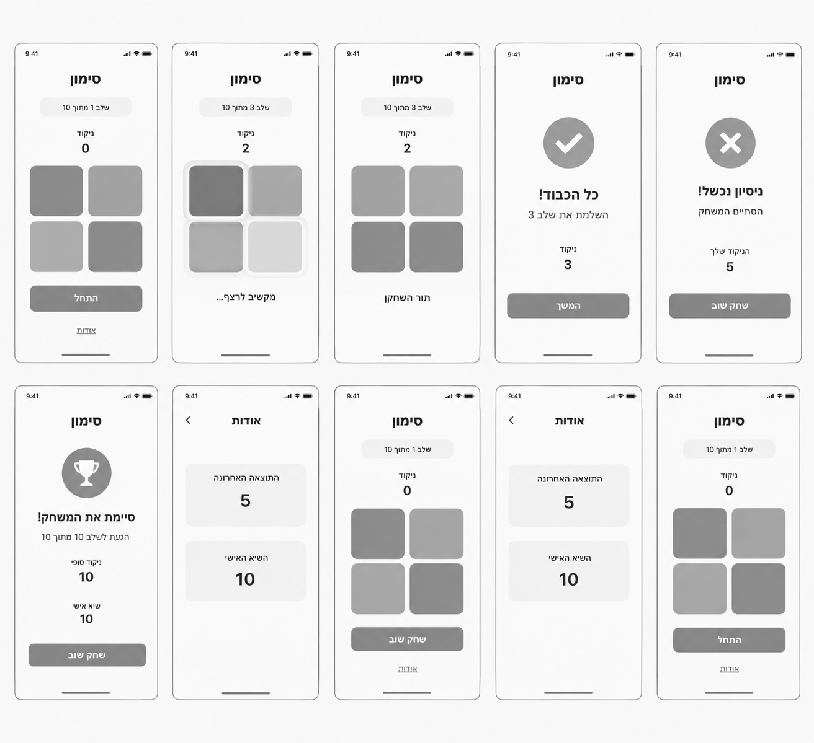
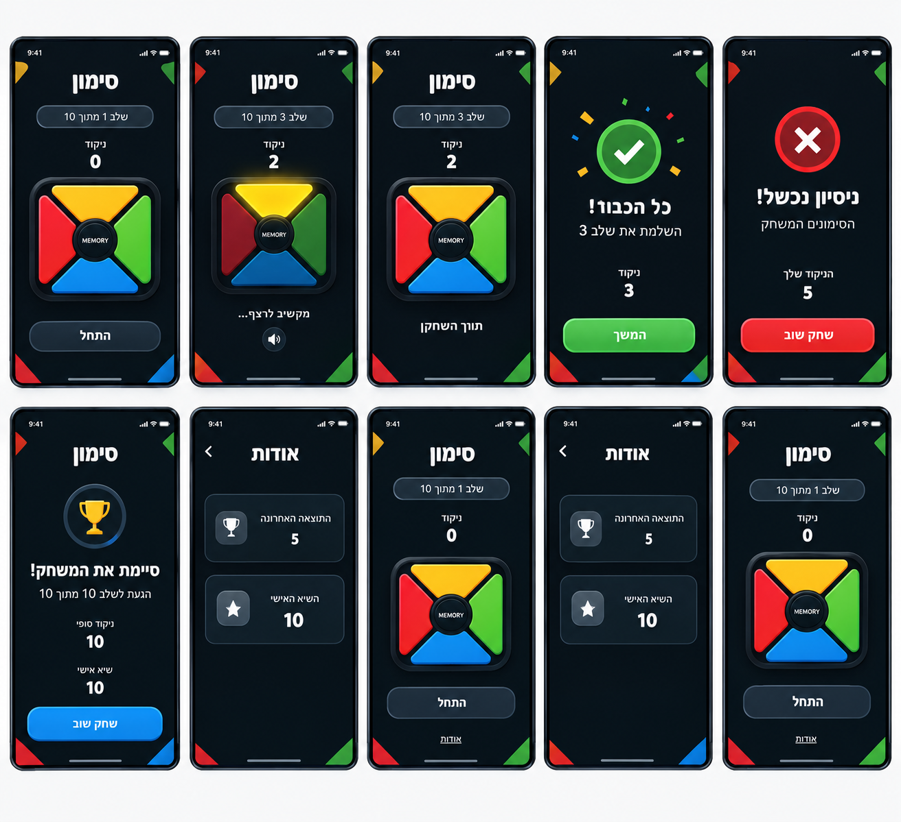
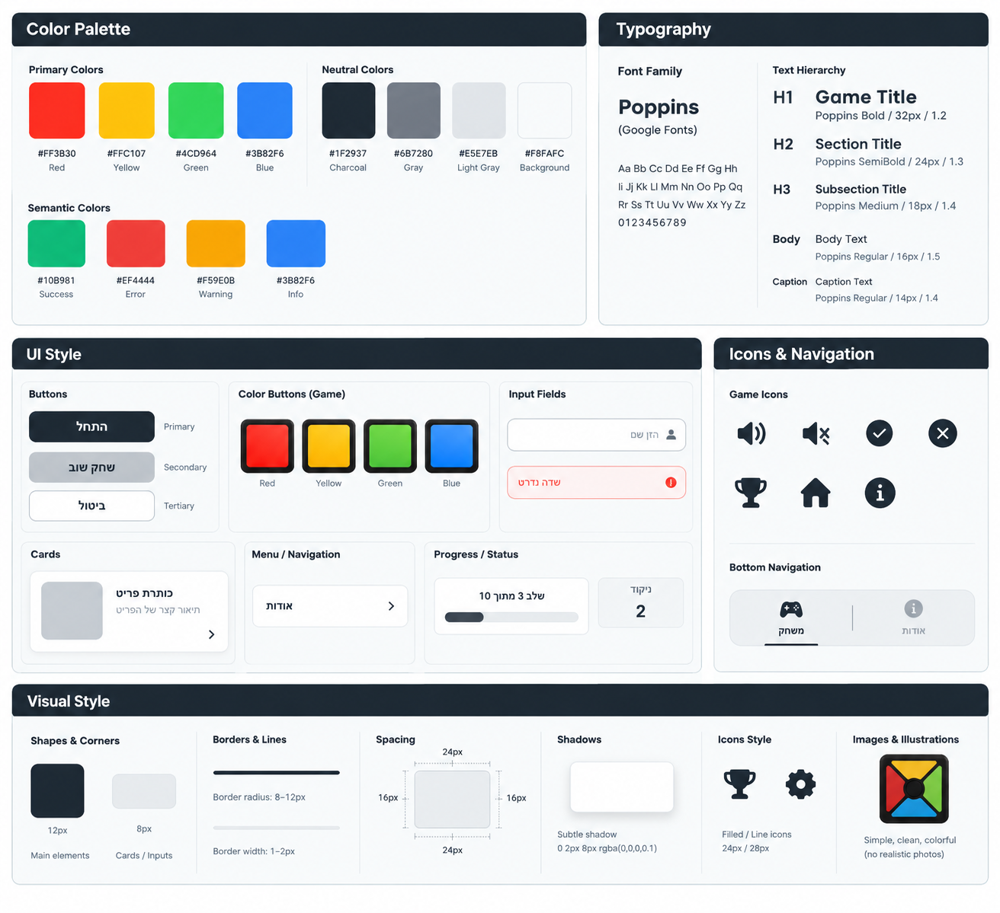

# DESIGN.md — משחק Simon

מסמך זה מתאר את המימוש העיצובי של ממשק המשחק. דרישות המוצר, התנהגות המשחק ועקרונות ה-UX מתועדים ב-PRD ואינם חוזרים כאן.

**מקורות:**
- **PRD** — דרישות, התנהגות ואילוצי UX.
- **Wireframes** — מבנה המסכים, הפריסה ורכיבי ה-UI.
- **Style Guide** — צבעים, טיפוגרפיה וסגנון רכיבים.
- **Mockups** — המראה החזותי הסופי.

כאשר יש סתירה בין המקורות, ה-PRD קובע את ההתנהגות, וה-Mockups קובעים את המראה. סתירות שזוהו מרוכזות בסעיף "נקודות פתוחות" בסוף המסמך.

---

## חלק 1: Screens — מסכי האפליקציה





לפי ה-PRD, באפליקציה שני מסכים בלבד: **מסך הבית (המשחק)** ו**מסך „אודות”**. מסכי ההצלחה, ההפסד והניצחון המופיעים ב-Wireframes וב-Mockups הם **מצבי תצוגה (States) של מסך הבית**, ולא מסכים נפרדים.

> שורת הסטטוס העליונה בתמונות (שעה 9:41, קליטה, סוללה) היא חלק ממסגרת המכשיר ואינה חלק מהממשק שיש לממש.

### מבנה משותף לכל מצבי מסך הבית

מלמעלה למטה, ממורכז אופקית:
1. **כותרת המשחק:** „סימון” — טקסט מודגש וגדול (H1).
2. **תג שלב (Status pill):** „שלב X מתוך 10” — מלבן מעוגל לגמרי (Pill) עם רקע כהה מעט מהרקע ומסגרת דקה.
3. **ניקוד:** תווית „ניקוד” בטקסט קטן, ומתחתיה המספר בטקסט גדול ומודגש. המספר הוא מספר השלבים שהושלמו.
4. **לוח המשחק** (ראו פירוט בהמשך).
5. **אזור פעולה / סטטוס:** כפתור או טקסט מצב, בהתאם למצב המשחק.
6. **קישור „אודות”:** טקסט קטן עם קו תחתון, בתחתית המסך.

**לוח המשחק (לפי ה-Mockups):**
- מסגרת ריבועית כהה עם פינות מעוגלות, ובתוכה ארבעה מקטעים משולשים הנפגשים במרכז.
- סידור הצבעים: **צהוב למעלה, ירוק מימין, כחול למטה, אדום משמאל.**
- במרכז עיגול כהה (ראו נקודה פתוחה לגבי הטקסט בתוכו).
- למקטעים מראה מבריק מעט, עם מסגרת כהה המפרידה ביניהם.
- ב-Wireframes הלוח מוצג כרשת 2×2 של ריבועים; המראה הסופי הוא זה שב-Mockups.

**עיטור רקע:** בפינות המסך מופיעים משולשים צבעוניים קטנים בצבעי המשחק (אדום, צהוב, ירוק, כחול). זהו עיטור בלבד, ללא פעולה.

---

### מסך 1: מסך הבית — מצב התחלה (`idle`)

**מטרת המסך:** לאפשר למשתמש להתחיל משחק חדש.

**מבנה ותוכן:**
- כותרת „סימון”.
- תג „שלב 1 מתוך 10”.
- „ניקוד” — 0.
- לוח המשחק בצבעים מלאים.
- כפתור ראשי „התחל” — רחב, כהה, עם מסגרת דקה בהירה וטקסט לבן מודגש.
- קישור „אודות” בתחתית.

**פעולות וניווט:**
- „התחל” ← מעבר למצב „הצגת רצף”.
- „אודות” ← מעבר למסך „אודות”.

> הערה: ה-PRD מגדיר הוראות משחק קצרות במסך הבית, אך הן אינן מופיעות ב-Wireframes או ב-Mockups. מיקומן ועיצובן לא הוגדרו (ראו נקודות פתוחות).

---

### מסך 1א: מסך הבית — הצגת רצף (`showing-sequence`)

**מטרת המצב:** להציג ולהשמיע את הרצף, כדי שהשחקן יזכור אותו.

**מבנה ותוכן:**
- תג השלב והניקוד מתעדכנים (לדוגמה: „שלב 3 מתוך 10”, ניקוד 2).
- **המקטע הפעיל** מואר בצבע בהיר עם הילה זוהרת (Glow) סביבו.
- **שאר המקטעים** מוצגים בגוון כהה ועמום, כדי להבליט את המקטע הפעיל ולסמן שהלוח נעול.
- במקום הכפתור: טקסט מצב „מקשיב לרצף...” ומתחתיו אייקון רמקול בתוך עיגול קטן. האייקון הוא חיווי בלבד ואינו כפתור.

**פעולות וניווט:** אין. הלוח נעול לקלט.

---

### מסך 1ב: מסך הבית — תור השחקן (`player-turn`)

**מטרת המצב:** לאפשר לשחקן לשחזר את הרצף.

**מבנה ותוכן:**
- תג השלב והניקוד הנוכחיים.
- לוח המשחק בצבעים מלאים ובהירים (פעיל).
- טקסט מצב: „תור השחקן”.

**פעולות וניווט:**
- לחיצה על מקטע צבע ← המקטע מואר ומושמע הצליל שלו.
- טעות ← מצב „הפסד”.
- שחזור נכון של כל הרצף ← מצב „הצלחה”, או מצב „ניצחון” אם זה שלב 10.

---

### מסך 1ג: מסך הבית — הצלחה בשלב (`transition`)

**מטרת המצב:** חיווי קצר שהשלב הושלם, לפני המעבר לשלב הבא.

**מבנה ותוכן (הלוח מוסתר ובמקומו מוצג החיווי):**
- אייקון וי (✓) לבן בתוך עיגול ירוק, עם קונפטי צבעוני קטן סביבו.
- כותרת: „כל הכבוד!”
- טקסט משנה: „השלמת את שלב X”.
- „ניקוד” והמספר המעודכן.

**פעולות וניווט:** לפי ה-PRD, המעבר לשלב הבא אוטומטי. ב-Wireframes וב-Mockups מופיע כפתור ירוק „המשך” — ראו נקודות פתוחות.

---

### מסך 1ד: מסך הבית — הפסד (`game-over`)

**מטרת המצב:** להודיע על סיום המשחק ולהציג את התוצאה.

**מבנה ותוכן (הלוח מוסתר):**
- אייקון X לבן בתוך עיגול אדום עם מסגרת אדומה בהירה.
- כותרת: „ניסיון נכשל!”
- טקסט משנה: „הסתיים המשחק” (הנוסח מה-Wireframes; ב-Mockups יש שגיאת הקלדה).
- „הניקוד שלך” והמספר הסופי.
- כפתור „שחק שוב” — רחב, **אדום**, טקסט לבן מודגש.

**פעולות וניווט:** „שחק שוב” ← משחק חדש (מצב „הצגת רצף” של שלב 1).

---

### מסך 1ה: מסך הבית — ניצחון (`won`)

**מטרת המצב:** להודיע על השלמת כל 10 השלבים.

**מבנה ותוכן (הלוח מוסתר):**
- אייקון גביע זהב בתוך עיגול כהה עם טבעת כחולה.
- כותרת: „סיימת את המשחק!”
- טקסט משנה: „הגעת לשלב 10 מתוך 10”.
- „ניקוד סופי” — 10.
- „שיא אישי” — הערך השמור.
- כפתור „שחק שוב” — רחב, **כחול**, טקסט לבן מודגש.

**פעולות וניווט:** „שחק שוב” ← משחק חדש.

---

### מסך 2: מסך „אודות”

**מטרת המסך:** להציג את התוצאה האחרונה ואת השיא האישי.

**מבנה ותוכן:**
- **כותרת עליונה:** „אודות” (ממורכזת, מודגשת), ולצידה חץ חזרה (Chevron). ב-Mockups החץ ממוקם משמאל לכותרת ופונה שמאלה.
- **כרטיס 1 — „התוצאה האחרונה”:** תווית, ומתחתיה המספר בגדול. בצד הכרטיס אייקון גביע בתוך ריבוע מעוגל.
- **כרטיס 2 — „השיא האישי”:** תווית ומספר גדול, עם אייקון כוכב בתוך ריבוע מעוגל.
- הכרטיסים כהים מעט מהרקע, עם פינות מעוגלות ומסגרת דקה, ומסודרים אחד מתחת לשני.
- אם אין נתונים שמורים, יוצג ערך התחלתי לפי ה-PRD.

**פעולות וניווט:** חץ החזרה ← חזרה למסך הבית.

---

### מבנה הניווט הכללי

```
מסך הבית (המשחק)  ⇄  מסך „אודות”
   │
   ├─ התחלה ──„התחל”──► הצגת רצף ──► תור השחקן
   │                         ▲             │
   │                         │        נכון │ טעות
   │                 הצלחה ◄─┘◄────────────┤
   │                                       ▼
   ├─ ניצחון (אחרי שלב 10) ──„שחק שוב”──► הפסד ──„שחק שוב”──► הצגת רצף
```

- מעבר מהבית ל„אודות”: קישור „אודות” בתחתית המסך.
- חזרה מ„אודות”: חץ החזרה בכותרת.
- כל שאר המעברים הם שינויי מצב בתוך מסך הבית.

---

## חלק 2: Style Guide — השפה העיצובית



### אווירה כללית
מראה מודרני, נקי וצבעוני, בסגנון משחק: **רקע כהה** (לפי ה-Mockups) שעליו בולטים ארבעת צבעי המשחק החזקים. אלמנטים מעוגלים, ניגודיות גבוהה, ומעט טקסט.

> ה-Style Guide מוצג על רקע בהיר, אך ה-Mockups (המראה הסופי) משתמשים ברקע כהה. המימוש יהיה ב-Dark theme, תוך שימוש בצבעים מה-Style Guide.

### Color Palette

**צבעי המשחק (Primary Colors):**

| צבע | HEX | שימוש |
|---|---|---|
| Red | `#FF3B30` | מקטע אדום בלוח |
| Yellow | `#FFC107` | מקטע צהוב בלוח |
| Green | `#4CD964` | מקטע ירוק בלוח |
| Blue | `#3B82F6` | מקטע כחול בלוח |

**צבעים ניטרליים (Neutral Colors):**

| צבע | HEX | שימוש |
|---|---|---|
| Charcoal | `#1F2937` | כפתור ראשי, כרטיסים ומשטחים כהים |
| Gray | `#6B7280` | טקסט משני ואייקונים לא פעילים |
| Light Gray | `#E5E7EB` | טקסט בהיר ומסגרות דקות על רקע כהה |
| Background | `#F8FAFC` | רקע בהיר (ב-Style Guide) / טקסט לבן |

**צבעים סמנטיים (Semantic Colors):**

| צבע | HEX | שימוש ב-Mockups |
|---|---|---|
| Success | `#10B981` | אייקון ✓ וכפתור במצב הצלחה |
| Error | `#EF4444` | אייקון X וכפתור „שחק שוב” במצב הפסד |
| Warning | `#F59E0B` | לא נמצא בשימוש במסכים |
| Info | `#3B82F6` | כפתור „שחק שוב” וטבעת הגביע במצב ניצחון |

**הערות:**
- רקע המסך ב-Mockups כהה מאוד (קרוב ל-Charcoal או כהה ממנו). ערך HEX מדויק לרקע הכהה לא הוגדר במקורות.
- הגוונים העמומים של המקטעים במצב „הצגת רצף” והגוון הזהוב של הגביע אינם מוגדרים כ-HEX; יש לגזור אותם מצבעי המשחק (גרסה כהה או בהירה של אותו צבע).

### Typography

**גופן:** Poppins (Google Fonts).

| רמה | משקל | גודל / גובה שורה | שימוש |
|---|---|---|---|
| H1 | Bold | 32px / 1.2 | כותרת „סימון”, כותרת „אודות” |
| H2 | SemiBold | 24px / 1.3 | כותרות מצב: „כל הכבוד!”, „ניסיון נכשל!”, „סיימת את המשחק!” |
| H3 | Medium | 18px / 1.4 | טקסט כפתורים |
| Body | Regular | 16px / 1.5 | טקסטי משנה וסטטוס („תור השחקן”) |
| Caption | Regular | 14px / 1.4 | תוויות („ניקוד”), תג השלב, קישור „אודות” |

- המספרים (ניקוד, תוצאות) מוצגים גדולים ומודגשים — ב-Mockups הם בולטים מעל H2.
- השיוך בין רמות הטקסט לרכיבים בטבלה מבוסס על ה-Mockups ואינו מוגדר במפורש ב-Style Guide.
- **חשוב:** Poppins אינו כולל אותיות עבריות. ראו נקודות פתוחות.

### UI Style

**כפתורים:**
- כפתורים רחבים (כמעט ברוחב התוכן), בצורת מלבן עם פינות מעוגלות מאוד, וטקסט מודגש וממורכז.
- **ראשי („התחל”):** רקע Charcoal, מסגרת דקה בהירה, טקסט לבן.
- **כפתורי סיום מצב:** רקע בצבע המצב — ירוק (הצלחה), אדום (הפסד), כחול (ניצחון) — עם טקסט לבן.
- ב-Style Guide מוגדרים גם כפתור Secondary (אפור בהיר) ו-Tertiary (לבן עם מסגרת); הם אינם מופיעים במסכים הסופיים.

**לחצני הצבע (לוח המשחק):**
- ב-Style Guide: ריבועים צבעוניים עם פינות מעוגלות ומסגרת כהה עבה.
- ב-Mockups (קובע): משולשים בתוך לוח ריבועי, עם מראה מבריק.
- **מצב מואר:** צבע בהיר יותר והילה זוהרת בצבע המקטע.
- **מצב נעול / לא פעיל:** גוון כהה ועמום.

**כרטיסים (Cards):**
- מלבן עם פינות מעוגלות (8px), מסגרת דקה וצל עדין.
- בתוכו: אייקון בריבוע מעוגל בצד אחד, ותווית ומספר בצד השני.
- במסך „אודות” הכרטיסים כהים, בהתאם ל-Dark theme.

**תג סטטוס (Status pill):** „שלב X מתוך 10” בתוך מלבן מעוגל לגמרי. ב-Style Guide מופיע גם פס התקדמות (Progress bar) מתחת לטקסט, אך הוא לא מופיע ב-Mockups ולכן אינו חלק מהמימוש.

**ניווט:**
- קישור טקסט „אודות” עם קו תחתון בתחתית מסך הבית.
- חץ חזרה (Chevron) בכותרת מסך „אודות”.
- רכיב Bottom Navigation („משחק” / „אודות”) מופיע ב-Style Guide, אך אינו מופיע במסכים הסופיים ואינו חלק מהמימוש.

**אייקונים:**
- סגנון מלא (Filled) או קווי (Line), בגודל 24px או 28px.
- בשימוש: רמקול, ✓, X, גביע, כוכב, חץ חזרה.
- אייקונים נוספים ב-Style Guide (השתקה, בית, מידע, הגדרות) אינם בשימוש — אין במוצר השתקה או הגדרות.

**שדות קלט (Input Fields):** מוגדרים ב-Style Guide, אך במוצר אין שדות קלט.

### Visual Style

- **פינות:** 12px לאלמנטים מרכזיים (לוח, כפתורים); 8px לכרטיסים. טווח כללי: 8–12px. כפתורים ב-Mockups מעוגלים יותר (כמעט Pill).
- **קווי מתאר:** עובי 1–2px, בגוון בהיר-אפור על רקע כהה.
- **צללים:** צל עדין — `0 2px 8px rgba(0,0,0,0.1)`. ב-Mockups ללוח המשחק צל עמוק יותר שנותן לו מראה בולט.
- **הילה (Glow):** סביב מקטע מואר, בצבע המקטע.
- **מרווחים (Spacing):** 16px בצדדים, 24px למעלה ולמטה (ריפוד פנימי של רכיבים ושולי המסך).
- **פריסה (Layout):** עמודה אחת אנכית, כל התוכן ממורכז אופקית, עבור מסך מובייל בלבד. כותרת למעלה, לוח במרכז, פעולה מתחת ללוח, קישור בתחתית.
- **איורים:** פשוטים, נקיים וצבעוניים, ללא תמונות ריאליסטיות. האלמנטים הגרפיים היחידים הם הלוח, האייקונים, הקונפטי ומשולשי העיטור בפינות.

### שפה וכיווניות

- **שפת הממשק:** עברית בלבד. כל הטקסטים בממשק (כותרות, כפתורים, תוויות, הודעות) בעברית.
- **כיווניות:** RTL — `lang="he"` ו-`dir="rtl"`.
- **יישור:** רוב הטקסטים ממורכזים. בכרטיסי „אודות”, הטקסט מיושר לפי RTL והאייקון בצד הנגדי.
- **מספרים:** ספרות רגילות (0–10).
- **מיקום צבעי הלוח קבוע** ואינו מתהפך ב-RTL: צהוב למעלה, ירוק מימין, כחול למטה, אדום משמאל.

---

## נקודות פתוחות

סתירות ופרטים לא ברורים שנמצאו במקורות. יש להחליט עליהם לפני המימוש:

1. **כפתור „המשך” במצב הצלחה:** מופיע ב-Wireframes וב-Mockups, אך ה-PRD קובע מעבר אוטומטי לשלב הבא. לפי ה-PRD — המעבר אוטומטי, ויש להחליט אם להסיר את הכפתור.
2. **הטקסט „MEMORY” במרכז הלוח:** באנגלית, בניגוד לדרישת עברית בלבד. יש להחליט אם להסיר אותו או להחליפו בטקסט עברי.
3. **גופן עברי:** Poppins אינו תומך באותיות עבריות. יש לבחור גופן עברי משלים, אחרת הדפדפן יציג גופן ברירת מחדל.
4. **הוראות משחק קצרות:** נדרשות ב-PRD, אך אינן מופיעות בעיצובים. מיקומן וסגנונן לא הוגדרו.
5. **צבע הרקע הכהה:** ערך HEX מדויק לא הוגדר.
6. **כיוון חץ החזרה במסך „אודות”:** ב-Mockups החץ משמאל ופונה שמאלה. יש לוודא שזה הכיוון הרצוי בממשק RTL.
